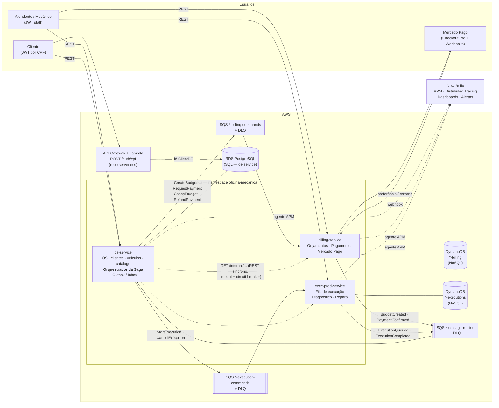
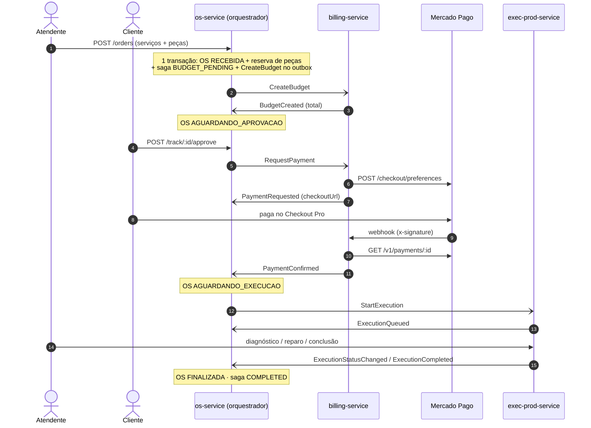
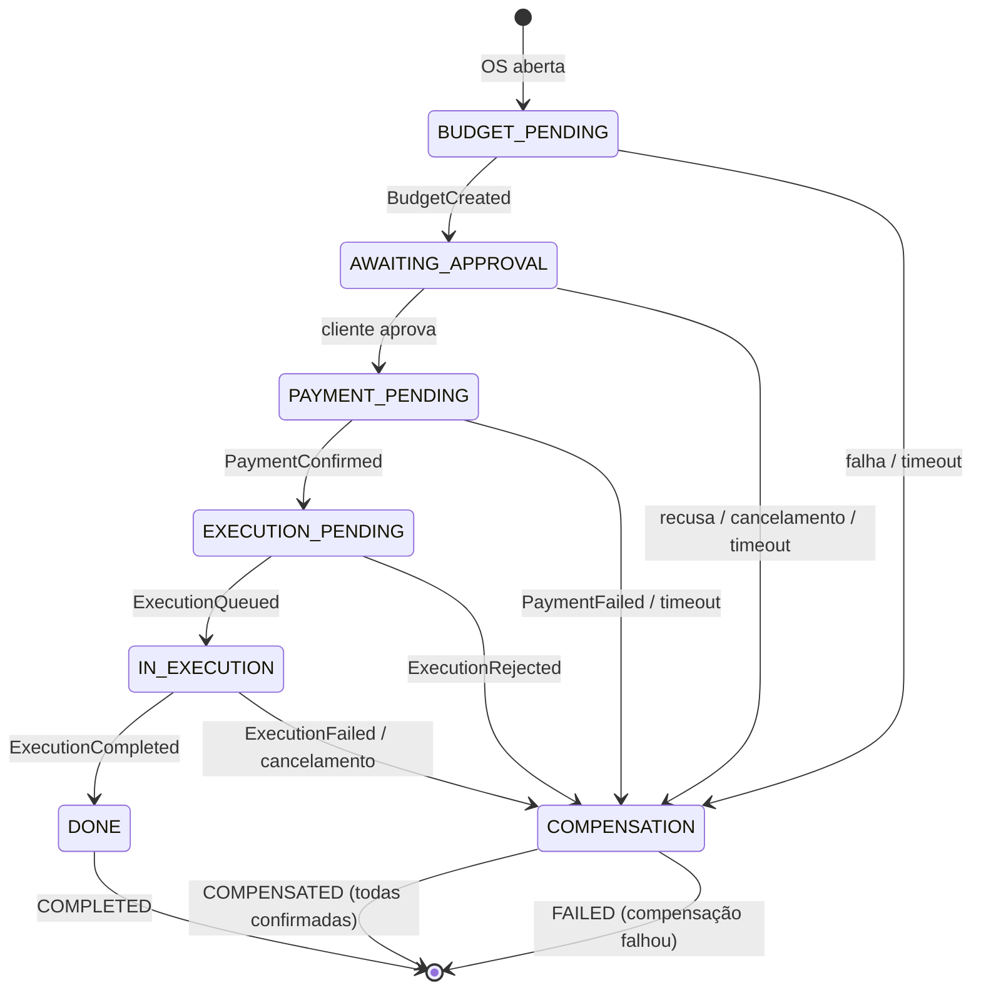

# Arquitetura — Fase 4 (microsserviços + Saga)

## Visão geral

| Serviço | Repositório | Responsabilidade | Banco | Porta |
|---|---|---|---|---|
| **os-service** | `soat-fiap-oficina-mecanica-os-service` | Abertura/status/histórico da OS, clientes, veículos, catálogo e estoque, login de funcionários. **Orquestra a saga.** | PostgreSQL (RDS) | 4000 |
| **billing-service** | `soat-fiap-oficina-mecanica-billing-service` | Orçamento (aprovação), cobrança Mercado Pago, webhook, estorno | DynamoDB | 4100 |
| **exec-prod-service** | `soat-fiap-oficina-mecanica-exec-prod` | Fila de execução, diagnóstico, reparo, conclusão/falha | DynamoDB | 4200 |

Cada serviço tem **repositório, pipeline, imagem Docker, manifestos Kubernetes, Terraform
(filas/tabelas/IAM) e banco próprios**. Nenhum serviço acessa o banco de outro: tudo que
cruza fronteira passa por mensagem (SQS) ou REST.

> A Lambda de login por CPF (repositório `serverless`) lê a tabela `ClientPF` do banco do
> os-service. Ela é tratada como parte do mesmo *bounded context* (identidade do cliente,
> dono dos dados = os-service) e só faz leitura — não é outro microsserviço de negócio.

## Saga orquestrada da OS

### Compensações (rollback semântico)

| Falha | Onde | Compensações enviadas | Locais |
|---|---|---|---|
| Orçamento inválido (`BudgetCreationFailed`) | billing | — | devolve peças ao estoque, OS `CANCELADA` |
| Cliente recusa / atendente cancela antes do pagamento | os-service | `CancelBudget` | idem |
| Cobrança não gerada / pagamento recusado (`PaymentFailed`) | billing / Mercado Pago | `CancelBudget` | idem |
| Oficina lotada (`ExecutionRejected`) | exec-prod | `RefundPayment` (estorno MP + cancela orçamento) | idem |
| Falha no reparo (`ExecutionFailed`) | exec-prod | `RefundPayment` | idem |
| Cancelamento com OS na fila/em execução | os-service | `CancelExecution` + `RefundPayment` | idem |
| Etapa parada além do limite (timeout) | os-service | conforme etapa | idem |
| Estorno recusado (`PaymentRefundFailed`) | Mercado Pago | — (sem rollback automático) | saga `FAILED` + **alerta New Relic** |

A decisão de **quais** compensações executar fica na entidade de domínio
[`OrderSaga.startCompensation`](../src/domain/saga/OrderSaga.js), a partir do que já foi
efetivado (orçamento criado? pagamento confirmado? execução na fila?). A saga fica
`COMPENSATING` até cada participante confirmar (`BudgetCancelled`, `PaymentRefunded`,
`ExecutionCancelled`) e então `COMPENSATED`.

## Garantias de consistência

| Problema | Solução | Onde |
|---|---|---|
| OS gravada mas comando não enviado (ou o contrário) | **Transactional Outbox**: mudança de estado + mensagem na mesma transação PostgreSQL; `OutboxRelay` publica depois (`FOR UPDATE SKIP LOCKED`) | os-service |
| Evento do mecânico perdido se o SQS falhar | **Outbox no próprio item** DynamoDB (escrita atômica) + republicação periódica via índice esparso `gsi2` | exec-prod |
| Mensagem entregue mais de uma vez (SQS at-least-once) | **Inbox** (`ProcessedMessage`, `ON CONFLICT DO NOTHING`) no orquestrador; *conditional writes* + handlers idempotentes nos participantes | todos |
| Duas réplicas atualizando a mesma saga/registro | **Lock otimista** (`version`) — conflito desfaz a transação e o SQS reentrega | todos |
| Mensagem que nunca processa (bug, dado inválido) | **DLQ** por fila (`maxReceiveCount = 5`, retenção 14 dias) | Terraform de cada serviço |
| Participante não responde | **Timeout por etapa** da saga → compensação | os-service |
| Cliente paga um link antigo de OS já cancelada | **Estorno automático** no billing | billing |
| Cobrança/estorno duplicado no Mercado Pago | `X-Idempotency-Key` em toda escrita | billing |
| Serviço remoto lento/fora em consultas síncronas | **Timeout + circuit breaker + resposta degradada** | os-service |

## Comunicação

- **Assíncrona (SQS)** — todo o fluxo transacional da saga (comandos e respostas). Contratos em [mensageria.md](mensageria.md).
- **Síncrona (REST)** — somente consultas: `GET /api/orders/:id/progress` e `GET /api/track/:externalId`
  do os-service compõem a visão da OS chamando `GET /api/internal/...` do billing e do exec-prod
  pelo DNS interno do Kubernetes, com JWT de serviço (`role: SERVICE`, 60s). Nenhuma escrita
  depende de chamada síncrona entre serviços.

## Observabilidade (ferramentas da Fase 3)

- **New Relic APM** nos três serviços (`oficina-os-service`, `oficina-billing-service`,
  `oficina-exec-prod-service`), com **Distributed Tracing atravessando o SQS**: o produtor
  injeta os headers W3C/New Relic no envelope (`traceHeaders`) e o consumidor os aceita numa
  *background transaction* — uma OS aparece como um único trace HTTP → SQS → billing → SQS → os-service.
- **Logs estruturados** (pino) com `x-request-id`, `sagaId`, `orderId` e `correlationId`, correlacionados ao trace.
- **Eventos de negócio**: `SagaStarted`, `SagaStepCompleted`, `SagaCompensationStarted`,
  `SagaCompensated`, `SagaCompleted`, `SagaFailed`, `PaymentStatusChanged`, `ExecutionStatusChanged`
  → página **"Saga e Microsserviços"** do dashboard e alertas (`SagaFailed`, pico de compensações)
  no repositório `infra-kube`.
- **Healthchecks** `GET /health` nas probes do Kubernetes; HPA por CPU/memória em cada serviço.
